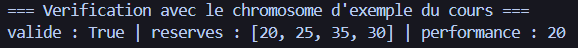
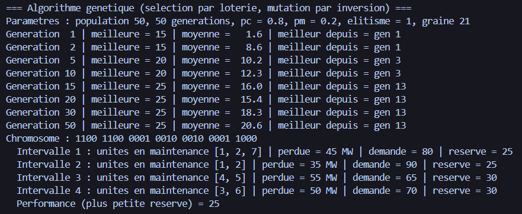
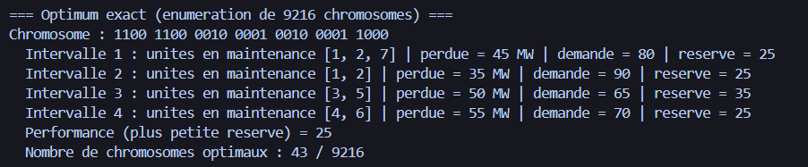
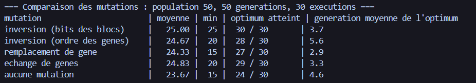
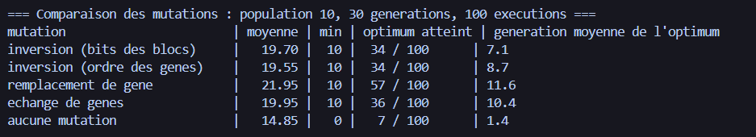
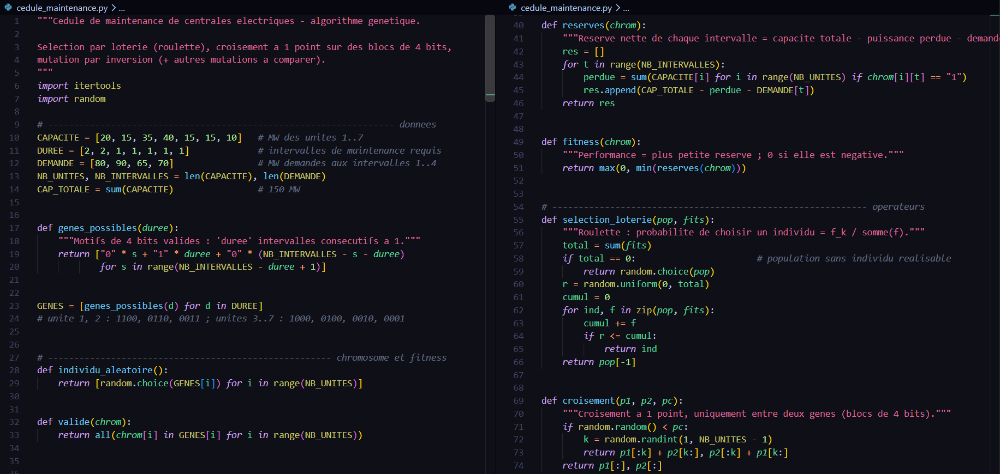
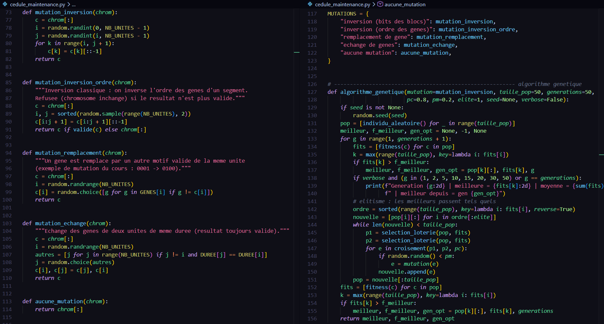
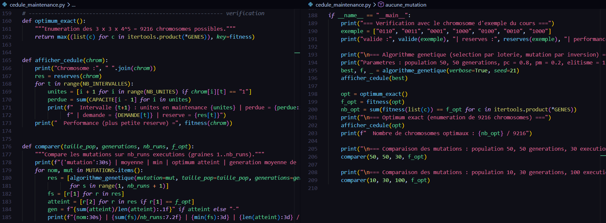

# TD - Métaheuristiques (Faculté des Sciences de Sfax)

Résolution de trois problèmes d'optimisation en Python (aucune bibliothèque externe, Python 3 seulement).

**Étudiante :** Bouassida Chayma  
**Filière :** Génie logiciel et systèmes d'information – 3e année  

## Contenu du dépôt

| Fichier | Contenu |
|---|---|
| `exercice2.py` | Exercice 2 : problème de transport (2 dépôts, 3 magasins), **recherche taboue** |
| `exercice3.py` | Exercice 3 : voyageur de commerce (8 villes) avec **recherche taboue**, **recuit simulé** et **algorithme génétique** |
| `cedule_maintenance.py` | Exercice 4 : ordonnancement de maintenance de centrales (algorithme génétique) |
| `compte_rendu_TD.pdf` | Compte rendu complet : modélisation, paramètres, traces d'exécution, comparaison |

## Exécution

    python exercice2.py
    python exercice3.py
    python cedule_maintenance.py

---

## Exercice 2 : Problème de transport

**Résultat** : coût minimal **52** (D1 -> M1, M2, M3 = 3, 5, 0 ; D2 -> 1, 0, 8). Solution initiale par coin nord-ouest (coût 55).

*Capture d'écran de l'exécution :*

*Code de l'exercice 2 :*

---

## Exercice 3 : Voyageur de Commerce (TSP)

**Résultats** (solution initiale 1-2-3-4-5-6-7-8-1, longueur 103) :

| Méthode | Meilleur tour | Longueur |
|---|---|---|
| Recherche taboue (15 itérations) | 1-8-3-7-6-5-4-2-1 | 98 |
| Recuit simulé (5 itérations, T0 = 20, alpha = 0,5) | 1-2-5-4-6-7-3-8-1 | 99 |
| Algorithme génétique (10 individus, 30 générations) | 1-8-3-7-6-4-5-2-1 | 99 |
| Force brute (vérification) | 1-2-4-5-6-7-3-8-1 | 98 |

*Remarque : avec seulement 5 itérations, le recuit simulé dépend fortement de la graine aléatoire (moyenne 102,8 sur 100 graines).*

*Capture d'écran de l'exécution :*

*Code de l'exercice 3 :*

### Hypothèses (Ex 2 et 3)
- Exercice 2 : la colonne « Dépôt » est le stock de chaque dépôt (8 et 9 containers).
- Exercice 3 : un tiret dans le tableau signifie « pas d'arête » (pénalité de 1000), distances symétriques.

---

## Exercice 4 : Ordonnancement de Maintenance

### 1. Modélisation du problème
L'objectif est de planifier la maintenance de 7 centrales électriques sur 4 intervalles afin de maximiser la réserve minimale d'électricité disponible.

* **Capacités :** `[20, 15, 35, 40, 15, 15, 10]` MW (Total = 150 MW)
* **Demandes :** `[80, 90, 65, 70]` MW
* **Contraintes :** Les unités 1 et 2 nécessitent 2 intervalles consécutifs. Les unités 3 à 7 nécessitent 1 intervalle.

**Fonction Objectif (Fitness) :**
La réserve d'un intervalle \(t\) est \(R_t = 150 - \text{Puissance perdue} - \text{Demande}_t\).
La performance (fitness) d'un chromosome est \(\max(0, \min(R_1, R_2, R_3, R_4))\).

### 2. Encodage
Chaque unité est un gène de 4 bits (`1` = en maintenance).
* Unités 1 et 2 : `1100`, `0110`, `0011`.
* Unités 3 à 7 : `1000`, `0100`, `0010`, `0001`.

*Exemple de chromosome valide (`0110 0011 0001 1000 0100 0010 1000`) avec une performance de 20 MW :*

### 3. Algorithme Génétique
* **Population :** 50 individus.
* **Générations :** 50.
* **Sélection :** Par loterie (Roulette Wheel).
* **Croisement :** À 1 point (uniquement entre les gènes, pour ne pas casser les blocs de 4 bits).
* **Élitisme :** Le meilleur individu est conservé à chaque génération.

*Évolution de l'algorithme au fil des générations (convergence vers 25 MW) :*

**Étude comparative des mutations** (probabilité 0.2) :
1. **Inversion (bits des blocs) :** Inverse les bits d'un bloc (ex: `1100` -> `0011`).
2. **Inversion (ordre des gènes) :** Inverse l'ordre des gènes d'un segment.
3. **Remplacement de gène :** Remplace un gène par un autre valide.
4. **Échange de gènes :** Échange deux gènes de même durée.
5. **Aucune mutation** (groupe témoin).

### 4. Résultats

L'algorithme converge vers l'optimum global de **25 MW**.

**Vérification exhaustive :** L'énumération des \(3^2 \times 4^5 = 9\,216\) combinaisons confirme que **25 MW** est la réserve maximale possible, avec **43 solutions optimales**.

*Résultat de la vérification exhaustive :*

**Comparaison des mutations :**

*(30 exécutions, pop=50, gen=50)*

*(100 exécutions, pop=10, gen=30)*

*Conclusion :* La mutation par **inversion des bits** est la plus performante et la plus robuste (100% de réussite sur 30 exécutions).

### 5. Code source (Exercice 4)

